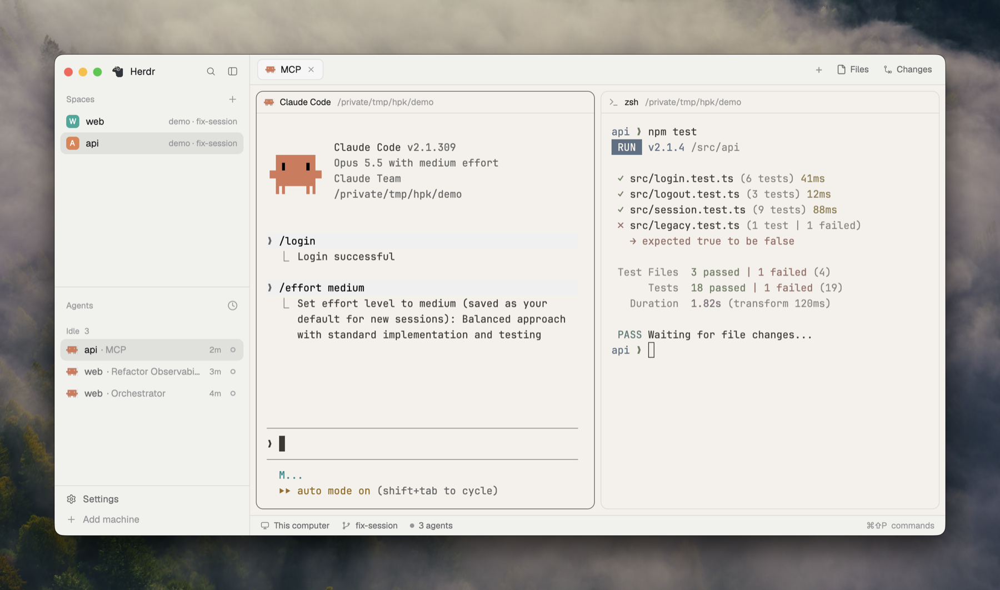

# Washi

A light theme for the [Herdr](https://herdr.dev) desktop app, named after the warm Japanese paper. The sidebar, tab bar and status bar use Herdr's built-in `paper` colors. The terminals and their pane headers use the warm cream and muted colors from [Kanso Day](https://github.com/jlopezlira/herdr-kanso), which is easier on the eyes than paper's white.



## Install

Ask your agent in Herdr:

```
Add the Herdr theme from github.com/edipox/herdr-washi
```

Or by hand:

```sh
curl -fsSL https://raw.githubusercontent.com/edipox/herdr-washi/main/themes/washi.json \
  -o ~/.config/herdr-app/themes/washi.json
```

Then pick `washi` in Settings, or run `herdr-app do app.theme --name washi`. To follow the system appearance, set `"theme": {"light": "washi", "dark": "graphite"}` in `~/.config/herdr-app/settings.json`.

## How it's built

The top-level `background`, `foreground`, `selection`, `cursor` and `ansi` values are Kanso Day's, so the terminals get them. Herdr would derive the panel colors from those too, so `colors` pins each one back to paper's value. `background` stays Kanso's because the pane frame and the pane header both draw with it. `canvas`, the gutter around the panes, is set to the same cream: Herdr doesn't clip pane content to the frame's rounded corners, so a different gutter color shows a square of terminal color at each corner.

## Credits

Terminal palette from [jlopezlira/herdr-kanso](https://github.com/jlopezlira/herdr-kanso) (Apache-2.0). Panel palette from Herdr's built-in `paper` theme.

## License

MIT
